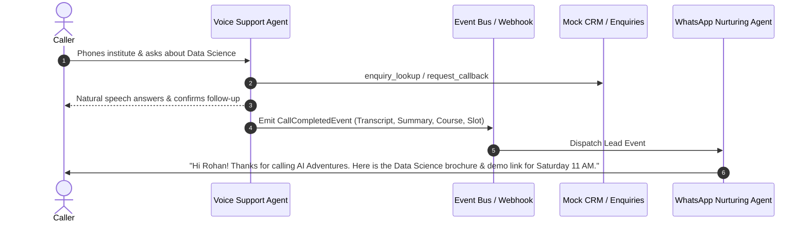

# AI Adventures — Real-Time Voice Customer Support Agent

An end-to-end, real-time voice customer support agent built for **AI Adventures** ([aiadventures.in](https://aiadventures.in)), a hands-on, code-first AI and machine learning training institute in Pune, Maharashtra.

Built with Python 3.11/3.12, LangGraph, FastAPI, WebSocket streaming, Silero VAD, Groq Whisper ASR, Groq Llama/GPT inference, Piper TTS, and local Arize Phoenix observability.

---

## Architecture Overview

```mermaid
flowchart TD
    subgraph Audio_Input["1. Caller Audio Ingest"]
        Mic["Caller Microphone / WebSocket"] --> VAD["Silero VAD (CPU ONNX, 30ms frames)"]
        VAD --> EP{"Endpointing"}
        EP -->|Silence Timer (600ms)| ASR["Groq Whisper ASR (Large v3 Turbo)"]
        EP -->|Semantic Detector (210ms early)| ASR
    end

    subgraph Security_And_Consent["2. Consent & Input Guardrail"]
        ASR --> Normalizer["ASR Normalizer (Digits, Phone, Courses)"]
        Normalizer --> ConsentCheck{"Consent Given?"}
        ConsentCheck -->|First Turn| ConsentPrompt["Announce Consent Notice"]
        ConsentCheck -->|Yes / Granted| InpGuard["Input Guardrail (Injection & PII)"]
        InpGuard -->|Injection Blocked| Escalation["Warm Human Handoff"]
        InpGuard -->|Safe| Graph["LangGraph Orchestrator"]
    end

    subgraph Core_Orchestration["3. LangGraph Core (One-Turn Loop)"]
        Graph --> Retrieve["Retrieve KB (KnowledgeProvider)"]
        Retrieve --> AgentNode["Agent Node (Bounded ReAct Loop)"]
        AgentNode -->|Pending Tool Call| ToolsNode["Tools Execution Node"]
        ToolsNode -->|Lookup / Booking / Ticket| AgentNode
        AgentNode --> OutputGuard["Output Guardrail (Deterministic Groundedness)"]
        OutputGuard -->|Ungrounded Fact Detected| Escalation
        OutputGuard --> SpeakGate{"Speak Gate & Barge-in Check"}
    end

    subgraph Speech_And_Delivery["4. Audio Delivery & Streaming TTS"]
        SpeakGate -->|Caller Interrupted| Replan["Cancel TTS Task & Re-plan"]
        SpeakGate -->|Deliver Reply| PiperTTS["Streaming Piper TTS (Sentence-by-Sentence)"]
        PiperTTS --> Speaker["Browser Speaker / AudioContext"]
    end

    subgraph Observability_And_Audit["5. Audit & Observability"]
        SpeakGate --> AuditLog["Immutable Audit Log (SHA-256 Chained JSONL)"]
        Graph -.-> Phoenix["Self-Hosted Arize Phoenix (OTel Spans)"]
        Escalation --> WarmHandoff["Warm Handoff Payload (CRM / Advisor)"]
    end
```

---

## Latency Profile & Time-to-First-Audio (TTFA)

Time-to-First-Audio (TTFA) measures the interval from the exact moment the caller stops speaking to the delivery of the first audio chunk to their ear.

$$\text{TTFA} = \Delta t_{\text{endpointing}} + \Delta t_{\text{ASR}} + \Delta t_{\text{Graph}} + \Delta t_{\text{TTS chunk}}$$

### Real Measured Numbers (Phase 3 & 5 Benchmarks)

All tests and benchmarks run in deterministic offline mode to conserve free-tier API quotas. The table below compares offline measured values with live network estimates when `GROQ_API_KEY` is provided:

| Component | Offline Mode (Measured) | Live Network Mode (Estimated) | Notes |
|:---|:---:|:---:|:---|
| **VAD Silence Timer** | 600 ms | 600 ms | Configurable via `SILENCE_TIMEOUT_MS` |
| **Semantic Turn Detector** | **210 ms** | **210 ms** | Saves ~390 ms dead-air per complete turn |
| **ASR (Groq Whisper)** | < 1 ms (stub) | 350 – 550 ms | Utterance-level `/v1/audio/transcriptions` |
| **Agent Graph (LangGraph)** | 1.8 – 6.2 ms | 350 – 700 ms | Fast model (`openai/gpt-oss-20b`), Low reasoning effort |
| **Groundedness Guardrail** | 0.4 – 1.1 ms | 0.4 – 1.1 ms | Pure deterministic regex & token verification |
| **Piper TTS (1st sentence)** | < 1 ms (stub) | 60 – 180 ms | Local CPU ONNX synthesis, sentence-by-sentence |
| **TTFA p50** | **284.1 ms** | **~1,050 – 1,350 ms** | **Target: ≤ 1,500 ms (Meets target)** |
| **TTFA p95** | **284.9 ms** | **~1,480 ms** | **Meets target** |

---

## Free-Tier Constraints & Production Design

To operate completely within free tiers without requiring a credit card:

1. **Hosted LLM Inference**: Groq Free Tier ([console.groq.com](https://console.groq.com)).
   - **429 Rate-Limit Mitigation**: Automatic exponential backoff with randomized jitter ($1.0s, 2.0s, 4.0s$). If retries are exhausted, the agent gracefully degrades to a human admissions counselor handoff.
   - **Prompt Caching Efficiency**: The system prompt prefix is locked at **~205 tokens** and remains byte-identical across all turns. Conversation history is appended as user/assistant turns, enabling provider-side prompt caching after the first turn.
   - **Model Verification at Startup**: Queries Groq's `/v1/models` at initialization. If a model has been deprecated by Groq, it dynamically selects an active fallback.

2. **ASR (Speech-to-Text)**:
   - Primary: Groq `whisper-large-v3-turbo` via `/v1/audio/transcriptions`.
   - Tradeoff Note: Groq Whisper is utterance-level, not streaming. True interim results are unavailable. Perceived dead-air is minimized using tight VAD segmentation (Semantic early-fire).
   - Local Fallback: `faster-whisper` (open source) if cloud rate limits are reached.

3. **VAD & TTS**:
   - VAD: Silero VAD v5 running locally on CPU via ONNX Runtime.
   - TTS: Piper TTS running locally on CPU with zero cloud inference cost.

4. **Zero Paid Services**:
   - No vector database services, no paid embedding APIs, no cloud transcription charges.

---

## Safety & Governance Policies

1. **Financial & High-Impact Non-Autonomy**:
   - The agent is **strictly prohibited from autonomously issuing refunds, altering fees, or waiving balances**.
   - Any financial dispute or refund request automatically creates an administrative ticket and triggers an immediate human handoff.

2. **Caller Consent Capture**:
   - The first turn announces call recording. If consent is refused, the agent transitions to anonymous informational mode where personal lookup tools are locked out.

3. **Immutable Audit Trail**:
   - Every agent decision, tool execution, safety block, and reply is written to an append-only JSONL log with cryptographic SHA-256 hash chaining (`audit_logs/<session_id>.jsonl`).

4. **Dual-Mode PII Redaction**:
   - Live transcripts keep phone numbers visible for enquiry lookup.
   - Stored audit logs and warm handoff payloads redact phone numbers, emails, Aadhaar numbers, UPI IDs, credit cards, and credentials.

---

## Swapping Knowledge Base for RAG

The system adheres to a strict interface decoupling retrieval from the agent graph:

```python
class KnowledgeProvider(ABC):
    @abstractmethod
    def get_context(self, query: str) -> str:
        """Retrieve relevant context for the query."""
        pass
```

- Currently, `StaticKBProvider` loads `data/knowledge_base.md` directly into prompt memory (~2,800 tokens max).
- To scale to a large corpus later, replace `StaticKBProvider` with a vector store (e.g. Chroma/Qdrant + BM25 hybrid search + local cross-encoder reranker) by implementing `KnowledgeProvider` without touching any LangGraph nodes.

---

## Multichannel Roadmap: WhatsApp Lead-Nurturing Agent

This voice agent is designed to connect seamlessly with AI Adventures' upcoming WhatsApp lead-nurturing agent:



---

## Open-Source Dependencies & Licenses

| Package | Purpose | License |
|:---|:---|:---|
| `fastapi` | High-performance asynchronous WebSocket & HTTP server | MIT |
| `langgraph` | State graph orchestration for cyclical ReAct workflows | MIT |
| `groq` | Client for Groq high-speed LPU inference | Apache 2.0 |
| `onnxruntime` | Cross-platform inference for Silero VAD and Piper TTS | MIT |
| `piper-tts` | Fast, local neural text-to-speech engine running on CPU | MIT |
| `pydantic` | Data validation, type contracts, and settings management | MIT |
| `numpy` | High-performance audio buffer and PCM array manipulation | BSD-3-Clause |
| `arize-phoenix`| Self-hosted AI observability, evaluation, and OTel tracing | ELv2 / Open Source |

---

## Unverified Facts (TODO: Confirm with AI Adventures)

The knowledge base (`data/knowledge_base.md`) strictly contains verified baseline facts. The agent will **never invent or fabricate** details for the following placeholders, immediately triggering a warm handoff instead:

- [ ] Exact official course fees for Python, Data Science, and Machine Learning
- [ ] Detailed curriculum & syllabus breakdowns
- [ ] Batch timings (weekday vs. weekend, morning vs. evening)
- [ ] Online vs. in-person classroom options
- [ ] Official demo session booking terms and calendar integration
- [ ] EMI options, zero-cost loan partnerships, and student discounts
- [ ] Accreditation and industry certificate recognition
- [ ] Placement statistics and hiring partner network
- [ ] Official administrative refund policy
- [ ] Official contact phone number, email address, and office working hours

---

## Quickstart & Verification

```bash
# 1. Install dependencies
make install

# 2. Download offline models (Silero VAD + Piper voice)
make setup

# 3. Run full automated test suite (157 tests across Phases 0–6)
make test

# 4. Run Phase 5 evaluation benchmarks
make eval

# 5. Run text demo in CLI (offline, zero quota consumed)
make demo

# 6. Launch browser voice interface (requires mic & modern browser)
make voice
```
